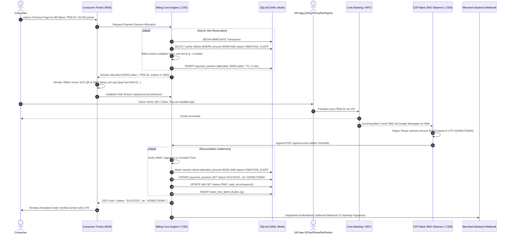

# 🏛️ Openbill Pay System

> **Zero-SaaS, Self-Hosted Recurring Bill Collection & Automated Peer-to-Peer Reconciliation Engine**

[](https://nodejs.org/)
[](https://sqlite.org/)
[](#)
[](#)
[](LICENSE)

| Attribute | Specification |
| :--- | :--- |
| **Status** | 🟢 Active / Production Ready |
| **License** | [MIT License](LICENSE) |
| **Stack** | Node.js, SQLite (WAL), Puppeteer (CDP), Baileys Socket |
| **Monetary Precision** | 64-bit Integer (Paise minor units) |
| **Runtime** | Bare-Metal Node.js 20+ LTS (Zero Docker) |

---

> [!WARNING]
> ### ⚠️ EXPERIMENTAL DEVELOPER UTILITY & RESEARCH PROJECT
> **Openbill Pay System** is an independent, open-source software experiment engineered for sovereign self-hosted automation research, programmatic bill dispatch, and payment observation studies. 
> 
> This project is **not** an official payment gateway, payment aggregator, or financial intermediary. It is not affiliated with, sponsored by, or endorsed by NPCI, UPI, Google LLC, WhatsApp Inc., Meta Platforms, or any banking institution. Users deploying this software do so under their own sovereign jurisdiction and administrative responsibility, in full compliance with their local banking terms of service and applicable telecommunication regulations.

---

## 💡 System Design Philosophy

1. **Zero External SaaS Fees**: Operates without payment gateway percentage cuts or expensive telecom SMS aggregator fees by leveraging open-source socket pairing (`@whiskeysockets/baileys`) and browser-level Chrome DevTools Protocol (`CDP`) observation.
2. **Strict 64-Bit Integer Minor Units (Paise)**: Prevents IEEE 754 floating-point drift across currency transactions by enforcing all calculations in **Paise** (`₹1.00 = 100 paise`).
3. **High-Concurrency SQLite WAL Engine**: Employs SQLite3 with Write-Ahead Logging (`PRAGMA journal_mode = WAL`), immediate reserved transaction locks (`BEGIN IMMEDIATE`), and busy timeouts for high concurrency with zero external database server overhead.
4. **Zero-Docker Native Runtime**: Entire multi-service topology runs natively with standard Node.js v20+ tools (`npm install`, `npm run bootstrap`, `npm run dev`).

---

## 🔬 Technical Flowchart: Fractional Invariant Allocation Engine

The core cryptographic innovation of Openbill is its **Fractional Slot Invariant Allocator**. Without paying gateway fees for custom Virtual Payment Addresses (VPAs), incoming peer-to-peer bank SMS notifications carry the exact credited amount and a 12-digit UTR, but no custom order ID. 

Openbill solves this by temporarily binding each active payment session to a unique minor-unit paise offset ($0, 1, 2 \dots 99\text{ paise}$). Incoming credit alerts for the exact sum resolve to the matching bill in $O(1)$ time:



---

## 📦 Monorepo Architecture & Microservices Matrix

| Microservice | Internal Port | Technology Stack | Core Responsibility |
| :--- | :--- | :--- | :--- |
| **`CORE-API`** | `7100` | Node.js, Express, SQLite WAL | Fractional Slot Allocator, DB Engine, Reconciler, SSE |
| **`CHECKOUT`** | `8000` | Express, Vanilla JS / CSS, QRCode | Mobile-Responsive Bottom Sheet, Deep Links, Offline Vector SVG QR |
| **`ADMIN-UI`** | `7001` | Express, HTML5 | Merchant Operations Dashboard, Settlement Metrics |
| **`WA-DUNNING`** | `7300` | `@whiskeysockets/baileys` | Multi-Device WhatsApp Socket Pairing & Morning Reminder Scheduler |
| **`SMS-OBS`** | `7200` | Puppeteer Core, Chrome CDP | Real-time Headless Google Messages SMS Credit Scraper |
| **`packages/database`**| Internal | Better-SQLite3, Drizzle ORM | Database schema definitions, WAL initialization & typed queries |
| **`packages/common`**  | Internal | Node Crypto, TypeScript | Constant-time HMAC-SHA256 signing & currency normalizers |

---

## 🛠️ Local Installation & Booting

### Prerequisites
- **Node.js**: v20.0.0+ LTS
- **npm**: v10.0.0+
- **Google Chrome**: For the CDP observer listener

```bash
# 1. Clone the repository
git clone https://github.com/your-username/openbill-pay-system.git
cd openbill-pay-system

# 2. Configure environment variables
cp .env.example .env

# 3. Bootstrap all packages and initialize SQLite database
npm run bootstrap

# 4. Launch all 5 microservices in the unified Process Control Center
npm run dev
```

The process control center supervisor will launch all 5 microservices simultaneously, aggregating their console streams with distinct color prefixes into a single terminal window:

```text
[CORE-API]   🚀 Openbill Pay Core API listening on http://localhost:7100
[CHECKOUT]   ⚡ Openbill Pay Consumer Portal running on http://localhost:8000
[ADMIN-UI]   📊 Openbill Admin Dashboard listening on http://localhost:7001
[WA-DUNNING] [WhatsApp Observer] Initializing multi-device session...
[SMS-OBS]    [CDP Listener] Connecting to Chrome via DevTools Protocol at http://127.0.0.1:9222...
```

---

## 🧪 Comprehensive Verification Suite

Run all verification tests across database concurrency, deep linking, bank parsers, and cryptographic signatures:

```bash
# Run the entire test matrix
npm test
```

Individual service test suites:
```bash
# 1. Fractional Slot Allocator & 10x Parallel Concurrency Test
node apps/billing-core/dist/allocator/slot-allocator.test.js

# 2. NPCI UPI URI Compiler & Vector SVG QR Generation Test
node apps/consumer-portal/dist/portal.test.js

# 3. Bank SMS Regex Parser (HDFC, ICICI, SBI, Axis) & HMAC Verification Test
node apps/observers/bank-sms/dist/bank-sms.test.js

# 4. Full End-to-End CDP Simulation to SQLite Settlement Test
node apps/observers/bank-sms/dist/e2e-integration.test.js

# 5. WhatsApp Multi-Device Scheduler & Anti-Spam Throttling Test
node apps/observers/whatsapp/dist/whatsapp.test.js

# 6. Authoritative Merchant Webhook Signature & HTTP Dispatch Test
node apps/billing-core/dist/webhook/merchant-webhook-notifier.test.js
```

---

## 🔐 Authoritative Webhook Integration

When a bill is settled, `CORE-API` generates an outbound webhook signed via HMAC-SHA256 with the merchant's secret:

```http
POST /webhook/openbill-pay HTTP/1.1
Content-Type: application/json
X-Gateway-Signature: sha256=469be4b005dfb274ea91822c72df21b53490d01ad81e34d3511758e69fa770ee
X-Gateway-Timestamp: 1776612000000

{
  "event": "SUCCESS",
  "orderId": "bill_001",
  "amount": 50002,
  "utr": "429381729384",
  "paymentId": "sess_15e1a3ee-876e-4145-bb59-ff02ffe7484c",
  "timestamp": 1776612000000
}
```

See [`apps/billing-core/docs/webhook-receiver-templates.md`](apps/billing-core/docs/webhook-receiver-templates.md) for production receiver templates in **Node.js (Express)** and **Python (FastAPI)**.

---

## 📜 License
Distributed under the **MIT License**. Engineered for researchers, local communities, and sovereign developers.
